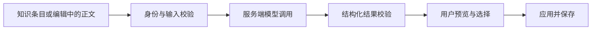

# KnowNest · 知巢

个人知识库与 AI 整理助手：把零散笔记、资料、Prompt 和项目经验整理成可搜索、可分类的知识条目。

支持 Markdown 编辑、标签与分类、组合筛选，以及摘要生成、标签推荐、分类推荐、标题优化和正文整理。AI 先返回候选结果，由用户预览并决定是否应用。

**Next.js · React · TypeScript · PostgreSQL · Drizzle ORM · Supabase Auth**

[本地启动](#本地启动) · [常用验证](#常用验证) · [架构说明](docs/technical/architecture.md) · [部署记录](docs/operations/self-hosting-migration.md)

## 一次使用流程

以整理一篇项目复盘为例：

1. 新建知识条目，输入标题和 Markdown 正文，放入工作空间。
2. 在 AI 助手中生成摘要，或获取标签、分类、标题与正文整理建议。
3. 阅读候选结果，选择应用或放弃；生成操作本身不会覆盖知识数据。
4. 通过标签、分类、关键词和状态筛选重新找到这篇复盘。

## 三个设计取舍

| 取舍 | 原因与边界 | 实现入口 |
| --- | --- | --- |
| 生成候选结果与应用结果分开 | 用户可以先检查 AI 内容；生成 API 负责结果校验，应用动作再校验身份和条目归属 | [AI 请求处理](src/app/api/ai/route-handler.ts)、[应用摘要](src/lib/knowledge/knowledge-item-summary.ts) |
| 模型选项由服务端维护 | 设置页可以选择允许的模型，API Key 和连接配置保留在服务端 | [模型配置](src/lib/ai/config.ts)、[Provider 工厂](src/lib/ai/provider-factory.ts) |
| 认证与业务数据各有统一入口 | 页面和组件通过认证、数据模块访问资源，集中处理用户归属和查询规则 | [认证层](src/lib/auth/server.ts)、[知识数据层](src/lib/db/knowledge-items.ts) |



## 阅读与验证入口

- AI 主流程：[请求处理](src/app/api/ai/route-handler.ts)、[结果校验](src/lib/ai/schemas.ts)、[路由测试](src/app/api/ai/route.test.mjs)。
- 知识整理交互：[AI 助手面板](src/components/ai/ai-assistant-panel.tsx)、[结果预览](src/components/ai/ai-result-preview.tsx)。
- 权限与数据：[上下文及归属检查](src/lib/ai/actions.ts)、[知识数据测试](src/lib/db/knowledge-items.test.mjs)。

当前功能基线为 V0.3，AI 能力聚焦单条知识整理。全知识库 RAG 问答、MCP 工具接入和模型输出质量评测尚未作为本仓库的已完成功能交付。现有自动化测试主要检查程序逻辑、提示词构造和接口行为，不代表模型输出质量评测结果。

本项目需要配置自己的认证、数据库和模型服务，运行方法见下文。历史 Vercel 地址的部署背景见[自托管迁移记录](docs/operations/self-hosting-migration.md)。

<details>
<summary>版本背景与完整功能清单</summary>

## 当前状态

- V0.1：基础知识库能力已完成并通过真实账号端到端验证。
- V0.2：知识管理体验增强已完成并上线，包含分类、标签搜索、组合筛选、排序和详情阅读视图。
- V0.3：AI 知识整理助手 MVP 已完成并上线，用户已确认线上真实使用正常。
- 当前下一阶段入口：先收敛 V0.4 范围，再进入实现。

最新状态记录见：

```text
docs/operations/workflow-status.md
docs/operations/v0.3-workflow-status.md
docs/operations/self-hosting-migration.md
docs/operations/ops-commands.md
docs/operations/vercel-deployment.md
```

## 核心能力

### 知识管理

- 用户登录、退出登录、会话保持和 `/app/**` 路由保护
- 知识条目列表、详情、新建、编辑、删除
- 收集箱、生活 / 工作空间、内容类型、状态、收藏和归档
- 标签添加、删除、筛选和按标签名搜索
- 分类系统：默认分类 + 用户自定义分类
- 标题 / 正文 / 标签基础搜索
- 空间、状态、类型、收藏、标签、分类组合筛选
- 最近更新、最近创建、最早创建排序
- Markdown 输入、预览和详情页阅读视图
- 桌面端和移动端基础响应式布局

### AI 知识整理

- AI 生成摘要
- AI 推荐标签
- AI 推荐分类
- AI 优化标题
- AI 整理正文
- AI 结果预览与应用
- AI 使用日志
- 基础每日使用限制
- 设置页模型选择，基于服务端 allowlist

AI 相关边界：

- 前端不得直接调用模型 Provider。
- 不允许使用 `NEXT_PUBLIC_DEEPSEEK_API_KEY` 或任何 `NEXT_PUBLIC_*` 变量承载 AI Provider 密钥。
- `/api/ai` 只生成候选结果，不直接覆盖知识数据。
- 所有应用动作都必须校验当前用户和知识归属。
- AI 日志只保存元信息，不保存完整正文。

## 技术栈

- Next.js App Router
- React 19
- TypeScript
- Tailwind CSS
- Supabase Auth
- PostgreSQL
- Drizzle ORM + `pg`
- OpenAI SDK / OpenAI-compatible Provider
- `react-markdown`

业务数据访问统一经过 `src/lib/db`，认证能力统一经过 `src/lib/auth`。页面和业务组件不要直接访问 Supabase SDK、SQL client 或 ORM。

</details>

## 本地启动

建议使用 Node.js 24，与仓库 Dockerfile 保持一致。启动前需准备 Supabase Auth、PostgreSQL，以及用于 AI 整理的模型服务配置；空环境变量模板不能直接运行完整业务。

Windows 下优先使用 `npm.cmd` / `npx.cmd`，避免 PowerShell 拦截 `.ps1`。

1. 安装依赖：

   ```bash
   npm.cmd install
   ```

2. 创建本地环境变量：

   ```powershell
   Copy-Item .env.example .env.local
   ```

   然后在 `.env.local` 中填写真实值。真实密钥只放在本地 `.env.local` 或目标部署环境变量中，不要提交到 Git，也不要写入文档。

   新数据库需先按[数据库设计](docs/technical/database-schema.md)核对认证关联与权限策略，再在自己的开发数据库中依次应用 [db/migrations](db/migrations) 下的迁移文件。开发服务器不会自动执行迁移。

3. 启动开发服务器：

   ```bash
   npm.cmd run dev
   ```

4. 打开：

   ```text
   http://localhost:3000
   ```

<details>
<summary>展开环境变量配置</summary>

## 环境变量

基础变量：

```env
NEXT_PUBLIC_SUPABASE_URL=
NEXT_PUBLIC_SUPABASE_ANON_KEY=
APP_URL=http://localhost:3000
NEXT_PUBLIC_APP_URL=http://localhost:3000
DATABASE_URL=
```

AI 默认配置：

```env
AI_PROVIDER=deepseek
DEEPSEEK_API_KEY=
DEEPSEEK_BASE_URL=https://api.deepseek.com
AI_MODEL_FAST=deepseek-v4-flash
AI_MODEL_DEFAULT=deepseek-v4-flash
AI_MODEL_QUALITY=deepseek-v4-pro
AI_DAILY_LIMIT=20
AI_MAX_INPUT_CHARS=8000
AI_MIN_INPUT_CHARS=20
```

服务端模型 allowlist：

```env
AI_DEFAULT_MODEL_ID=deepseek-default
AI_MODEL_OPTIONS=[{"id":"deepseek-default","label":"DeepSeek 默认","provider":"openai-compatible","baseUrl":"https://api.deepseek.com","apiKeyEnv":"DEEPSEEK_API_KEY","model":"deepseek-v4-flash"},{"id":"xiaomi-mimo-token-plan-pro","label":"Xiaomi MiMo Token Plan Pro","provider":"openai-compatible","baseUrlEnv":"XIAOMI_MIMO_TOKEN_PLAN_BASE_URL","apiKeyEnv":"XIAOMI_MIMO_TOKEN_PLAN_API_KEY","model":"mimo-v2-pro"}]
```

Xiaomi MiMo Token Plan：

```env
XIAOMI_MIMO_TOKEN_PLAN_API_KEY=
XIAOMI_MIMO_TOKEN_PLAN_BASE_URL=https://token-plan-cn.xiaomimimo.com/v1
```

注意：

- `AI_MODEL_OPTIONS` 必须保持为单行 JSON。
- `apiKeyEnv` 只能写环境变量名，不能写真实 key。
- `NEXT_PUBLIC_SUPABASE_URL` 和 `NEXT_PUBLIC_SUPABASE_ANON_KEY` 是浏览器端可见变量，这是 Supabase Auth 的预期用法。
- `DATABASE_URL` 和所有 AI Provider API Key 都必须是服务端变量。

</details>

## 常用验证

部署前建议运行：

```bash
npm.cmd run lint
npm.cmd run test:ai
npm.cmd run test:knowledge-items
npm.cmd run test:tags
npm.cmd run test:categories
npm.cmd run test:knowledge-item-draft
npm.cmd run test:knowledge-list-item
npm.cmd run test:security
npm.cmd run build
git diff --check
```

其他局部测试脚本见 `package.json`。

<details>
<summary>数据库迁移、部署与维护参考</summary>

## 数据库迁移

已存在的迁移：

```text
db/migrations/0001_initial_schema.sql
db/migrations/0002_categories_search_sort.sql
db/migrations/0003_ai_assistant.sql
```

不要在未确认目标数据库的情况下执行 migration。执行任何线上或共享数据库 migration 前，必须先明确目标环境并获得确认。

## 部署

当前 Production 由 Mac mini Docker 承接。生产环境变量放在不提交的 `.env.production`，并通过生产 compose 启动：

```bash
docker compose --env-file .env.production up -d --build
```

历史 Vercel 部署记录保留在：

```text
docs/operations/vercel-deployment.md
```

自托管迁移记录和环境变量清单见：

```text
docs/operations/self-hosting-migration.md
```

## 文档目录

核心文档位于 `docs/`：

```text
docs/product/product-outline.md            产品总纲
docs/operations/workflow-status.md          总工作流状态
docs/operations/v0.3-agent-context.md       V0.3 AI 工作上下文
docs/operations/v0.3-workflow-status.md     V0.3 工作流状态
docs/operations/ops-commands.md             日常运维命令
docs/operations/vercel-deployment.md        Vercel 部署记录
docs/versions/v0.3/prd.md                   V0.3 PRD
docs/versions/v0.3/technical-design.md      V0.3 技术设计
docs/versions/v0.3/implementation-plan.md   V0.3 历史实施计划
docs/technical/architecture.md              技术架构
docs/technical/database-schema.md           数据库设计
```

开始新任务前，优先阅读：

```text
AGENTS.md
docs/operations/workflow-status.md
docs/operations/v0.3-agent-context.md
docs/operations/v0.3-workflow-status.md
```

## 项目结构

```text
src/app                  Next.js 页面、路由和 Server Actions
src/app/api/ai           AI 统一 API
src/components/ai        AI 助手、预览和标签建议组件
src/components/layout    应用外壳、侧边栏、移动端导航
src/components/knowledge 知识列表、搜索、筛选和条目展示
src/components/tags      标签输入和筛选
src/components/markdown  Markdown 编辑与预览
src/lib/ai               AI 配置、Provider、Prompt、Schema、错误和限流
src/lib/auth             认证边界
src/lib/db               数据访问边界
src/lib/supabase         Supabase adapter
src/types                业务类型
src/constants            业务常量
db/migrations            数据库迁移 SQL
```

## 下一阶段建议

V0.4 开始前建议先做范围收敛，从以下方向选择 1 到 2 条主线：

- AI 质量：Prompt 评估样例、模型选择说明、Provider 可用性监控
- AI 可观测性：失败日志后台查看、限流提示体验、Provider 异常归因
- 工程质量：统一测试聚合脚本、真实浏览器 smoke test、关键 Server Action 集成测试
- 产品体验：移动端细节、错误边界、登录态失效处理、知识管理效率优化

</details>
